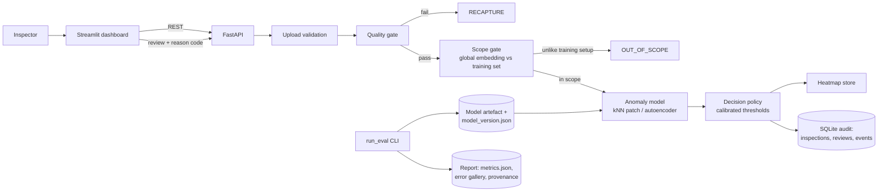

# Architecture (MVP)

## Core records

| Entity | Key fields | Where |
|---|---|---|
| Inspection | inspection_id, created_at, input_sha256, category, model_version, preprocessing_version | `schemas.InspectionResponse` |
| Prediction | anomaly_score, thresholds, decision, scope (in_scope, distance, threshold), heatmap_uri, latency_ms | same |
| HumanReview | reviewer_id, disposition, reason_code, comment, reviewed_at | `schemas.HumanReview` |
| ModelVersion | model_id, method, dataset, category, config_hash, seed, metrics_uri, artefact_uri, status | `schemas.ModelVersion` |
| AuditEvent | actor, action, object_id, request_id, result, timestamp | `schemas.AuditEvent` |

Planned: `SensorWindow` (Phase 5), monitoring/drift store (Phase 6), ONNX artefacts with hardware profile (Phase 4).
