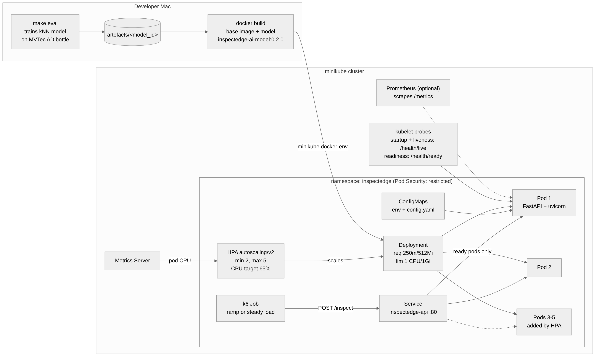

# Running InspectEdge AI on Kubernetes (minikube)

A small, reproducible deployment of the inspection API: probes, CPU/memory controls, CPU-based
autoscaling (HPA), Prometheus metrics, an in-cluster load test and failure drills.
Target time on a fresh Mac: **about 20–30 minutes**, plus model training if you haven't trained one.



## What gets deployed

| File | What it does |
|---|---|
| `k8s/namespace.yaml` | `inspectedge` namespace with Pod Security **restricted** enforced |
| `k8s/configmap.yaml` | `inspectedge-env` (settings as env vars) and `inspectedge-app-config` (`config.yaml`, mounted as a file; must match the trained model's config, checked by a test) |
| `k8s/deployment.yaml` | API pods: non-root UID 10001, read-only root FS, requests 250m CPU / 512Mi, limits 1 CPU / 1Gi, startup/readiness/liveness probes, no `replicas` (HPA owns it) |
| `k8s/service.yaml` | ClusterIP Service on port 80 → only **ready** pods |
| `k8s/hpa.yaml` | `autoscaling/v2`, min 2, max 5, target 65% of CPU request, 2 min scale-down window |
| `k8s/kustomization.yaml` | Applies everything in the right order: `kubectl apply -k k8s/` |
| `tests/load/k6.js`, `k6-job.yaml` | k6 load test that runs **inside** the cluster, so load is spread by the Service |

No Secrets: the app needs none. If one is ever added, create it with `kubectl create secret`;
never commit its value.

### Probes

| Probe | Endpoint | Meaning | Settings |
|---|---|---|---|
| startup | `/health/live` | Gives slow starts (torch import + model load) up to 180 s before liveness applies | every 5 s × 36 |
| readiness | `/health/ready` | Model loaded, audit DB answers, pod not draining → in Service endpoints | every 5 s, 2 failures |
| liveness | `/health/live` | Event loop responds. Never checks the model or DB, so a dependency problem doesn't cause restart loops | every 10 s, 3 failures |

Inference runs in a worker thread (at most `INSPECTEDGE_MAX_CONCURRENT_INFERENCES=2` per pod),
so a busy pod still answers its liveness probe. Without this, the CPU-bound `/inspect` handler
blocked the event loop and saturated pods could have been restarted under load
(`tests/test_ops_endpoints.py::test_liveness_answers_while_inference_runs`).

## Prerequisites (macOS)

```bash
brew install minikube kubectl          # Docker Desktop must be installed and running
```

Give Docker Desktop at least 4 CPUs and 8 GB memory (Settings → Resources).

You need a trained model artefact. If you haven't made one yet (see the main README):

```bash
make venv install install-ml          # once
# download MVTec AD "bottle" into data/raw/mvtec_ad/ (data/README.md)
make prepare eval                      # prints: Artefact: artefacts/<model_id>
```

## Run it

```bash
scripts/k8s/cluster-up.sh       # minikube (4 CPU, 6 GB) + Metrics Server
scripts/k8s/build-images.sh     # builds base + model image inside minikube (no registry)
scripts/k8s/deploy.sh           # kubectl apply -k k8s/, waits for Ready pods and HPA metrics
scripts/k8s/smoke-test.sh       # health, readiness, metrics, one real /inspect
scripts/k8s/load-test.sh        # ~7.5 min ramp + scale-down watch → reports/k8s/<ts>-load/
scripts/k8s/recovery-test.sh    # failure drills under steady traffic → reports/k8s/<ts>-recovery/
scripts/k8s/cleanup.sh          # remove everything (DELETE_CLUSTER=1 also deletes minikube)
```

The same steps are available as `make k8s-up k8s-build k8s-deploy k8s-smoke k8s-load k8s-recovery k8s-clean`.

Useful while it runs (second terminal):

```bash
kubectl -n inspectedge get pods,hpa -w
kubectl -n inspectedge top pods
kubectl -n inspectedge get endpointslices -o wide
```

## What the tests do

**Load test** (`load-test.sh`): k6 ramps 4 → 12 virtual users over 4 minutes, holds 2 minutes,
ramps down. Every 10 s it records HPA CPU %, current/desired/ready replicas and per-pod
CPU/memory (`timeline.tsv`). After the load it keeps sampling until the HPA is back at 2
replicas. `summary.txt` contains p50/p95/p99 latency, throughput, error rate, peak replicas,
time to first scale-up and time to scale back down. Tune with `MAX_VUS=20`.

**Recovery test** (`recovery-test.sh`), while k6 sends a steady 2 req/s:

| Drill | How | What you should see |
|---|---|---|
| A. Pod deleted | `kubectl delete pod` | Deployment creates a replacement; time until it is Ready is recorded |
| B. Readiness fails | `touch /tmp/inspectedge.drain` in a pod | Pod marked not-ready in Service endpoints, **0 restarts**, traffic goes to other pods; returns when the file is removed |
| C. Slow startup | `INSPECTEDGE_STARTUP_DELAY_SECONDS=60` rollout | Startup probe waits; `maxUnavailable: 0` keeps old pods serving; rollout time recorded |
| C2 (optional) | `WITH_FAILING_STARTUP=1`, delay 240 s > 180 s budget | Kubelet kills and restarts the new container, rollout stalls, old pods keep serving |

The k6 error rate in `recovery.txt` shows whether any requests failed during the drills.

## Tuning resources from measurements

The 250m / 512Mi request and 1 CPU / 1Gi limit are starting values. After the load test:

- Memory: take the highest pod memory in `timeline.tsv`, set the request near it and keep the
  limit about 1.5–2× above it. Each kNN inference can briefly use a few hundred MB, which is why
  concurrency per pod is capped at 2.
- CPU: if pods sit at the 1-CPU limit (throttling) while p95 grows, more replicas help more than
  a bigger limit (one uvicorn worker and `OMP_NUM_THREADS=1` per pod).
- Record any change and the reason in `docs/results.md`.

## Known limitations

- **Per-pod state.** The SQLite audit DB and heatmaps live in each pod's `emptyDir`. They are
  lost when a pod goes away, and `GET /inspections/{id}` or `/heatmaps/{id}` can 404 if the
  Service routes the follow-up request to another pod. Fixing this needs a shared database
  (e.g. PostgreSQL) and object storage; out of scope for this deployment.
- **Local images only.** `imagePullPolicy: Never`; images are built inside minikube. The model
  image contains weights learned from MVTec AD (CC BY-NC-SA 4.0), so don't push it to a public
  registry.
- **No auth, no TLS, no Ingress.** Access is via `kubectl port-forward` only. Don't expose it.
- **Single-node cluster.** Scaling shows scheduling and load balancing, not resilience to node
  failure. The HPA scales on CPU only.
- **CI** (`.github/workflows/ci.yml`, job `k8s-smoke`) deploys the image *without* a model on
  kind (MVTec isn't redistributed), so it checks apply, probes, Service routing, self-healing and
  HPA metrics, not inference. Load and recovery numbers come from local runs.
